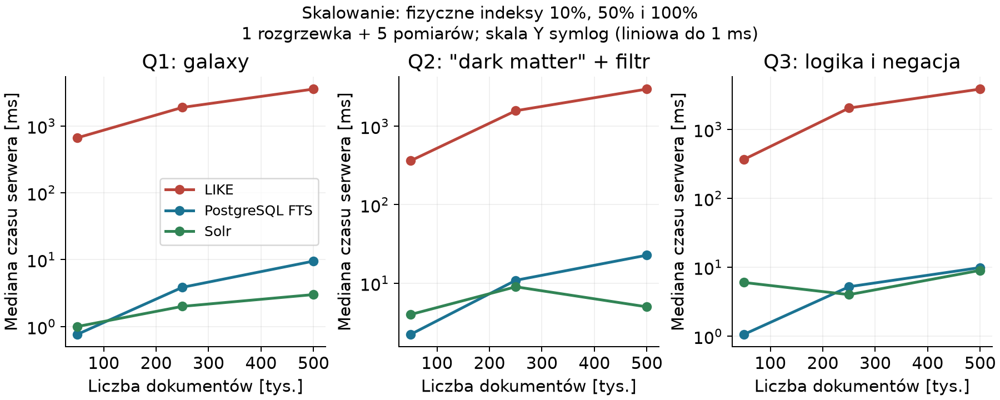

# Wyniki części na 5.0

Rzeczywiste wyniki z lokalnego uruchomienia. Zakres: dodatki do istniejącej pracy na 3.0/4.0.

LIKE rozróżnia wielkość liter i wyszukuje podciągi w oryginalnym title i abstract; nie użyto ILIKE ani lower(). Serię LIKE zmierzono ponownie 2026-11-18; serie FTS i Solra pochodzą z pierwotnych pomiarów. Dla LIKE odtworzono fizyczne podzbiory z pełnej tabeli i potwierdzono ich identyfikatory SHA256.

## Skalowanie - mediana czasu serwera [ms]

| Dokumenty | Q | LIKE | PG FTS | Solr QTime | Solr klient |
|---|---|---|---|---|---|
| 50 103 | Q1 | 663.64 | 0.90 | 1.00 | 5.19 |
| 50 103 | Q2 | 363.35 | 2.23 | 4.00 | 8.38 |
| 50 103 | Q3 | 367.17 | 1.06 | 6.00 | 11.27 |
| 250 183 | Q1 | 1 887.58 | 3.85 | 2.00 | 6.11 |
| 250 183 | Q2 | 1 572.84 | 10.89 | 9.00 | 13.39 |
| 250 183 | Q3 | 2 036.01 | 5.21 | 4.00 | 8.21 |
| 500 000 | Q1 | 3 546.80 | 9.49 | 3.00 | 9.93 |
| 500 000 | Q2 | 2 967.83 | 22.73 | 5.00 | 13.79 |
| 500 000 | Q3 | 3 830.65 | 9.87 | 9.00 | 14.09 |

## Liczby trafień

| Dokumenty | Q | LIKE | PG FTS | Solr |
|---|---|---|---|---|
| 50103 | Q1 | 774 | 831 | 832 |
| 50103 | Q2 | 186 | 206 | 208 |
| 50103 | Q3 | 337 | 465 | 468 |
| 250183 | Q1 | 3763 | 4027 | 4032 |
| 250183 | Q2 | 999 | 1095 | 1109 |
| 250183 | Q3 | 1806 | 2429 | 2433 |
| 500000 | Q1 | 7582 | 8133 | 8143 |
| 500000 | Q2 | 1959 | 2149 | 2172 |
| 500000 | Q3 | 3628 | 4858 | 4865 |

## Facety kontra GROUP BY [ms]

| Operacja | Serwer | Klient |
|---|---|---|
| main_cat | 10.25 | 12.25 |
| sub_cat | 10.78 | 11.52 |
| year | 11.31 | 13.17 |
| SQL GROUPING SETS (całość) | 14.92 | 16.42 |
| Solr: 3 facety razem | 11.00 | 20.32 |
| SQL: 3 zapytania kolejno | - | 35.21 |

Zgodność facetów dla zapytania pełnotekstowego: {'main_cat': False, 'sub_cat': False, 'year': False}

Kontrola agregacji dla identycznego zbioru (*:* / TRUE): zgodna we wszystkich koszykach.

### Liczebności: main_cat

| Koszyk | SQL | Solr |
|---|---|---|
| astro-ph | 7796 | 7804 |
| cond-mat | 2 | 2 |
| cs | 51 | 52 |
| eess | 3 | 3 |
| gr-qc | 123 | 123 |
| hep-ex | 3 | 3 |
| hep-ph | 74 | 74 |
| hep-th | 7 | 7 |
| math | 5 | 5 |
| nlin | 3 | 3 |
| nucl-ex | 1 | 1 |
| nucl-th | 1 | 1 |
| physics | 45 | 45 |
| q-bio | 3 | 4 |
| q-fin | 1 | 1 |
| quant-ph | 2 | 2 |
| stat | 13 | 13 |

### Liczebności: sub_cat

| Koszyk | SQL | Solr |
|---|---|---|
| astro-ph | 4 | 4 |
| astro-ph.CO | 1695 | 1697 |
| astro-ph.EP | 53 | 53 |
| astro-ph.GA | 4661 | 4663 |
| astro-ph.HE | 832 | 832 |
| astro-ph.IM | 370 | 374 |
| astro-ph.SR | 181 | 181 |
| cond-mat.dis-nn | 1 | 1 |
| cond-mat.mtrl-sci | 1 | 1 |
| cs.AI | 3 | 3 |
| cs.CL | 3 | 3 |
| cs.CV | 13 | 13 |
| cs.CY | 2 | 2 |
| cs.DC | 4 | 4 |
| cs.HC | 3 | 3 |
| cs.IT | 1 | 1 |
| cs.LG | 15 | 15 |
| cs.NE | 1 | 1 |
| cs.NI | 1 | 1 |
| cs.SC | 2 | 2 |
| cs.SE | 3 | 4 |
| eess.AS | 1 | 1 |
| eess.IV | 1 | 1 |
| eess.SP | 1 | 1 |
| gr-qc | 123 | 123 |
| hep-ex | 3 | 3 |
| hep-ph | 74 | 74 |
| hep-th | 7 | 7 |
| math.AP | 1 | 1 |
| math.CO | 2 | 2 |
| math.FA | 1 | 1 |
| math.OC | 1 | 1 |
| nlin.CD | 3 | 3 |
| nucl-ex | 1 | 1 |
| nucl-th | 1 | 1 |
| physics.ao-ph | 1 | 1 |
| physics.ed-ph | 2 | 2 |
| physics.flu-dyn | 1 | 1 |
| physics.gen-ph | 20 | 20 |
| physics.hist-ph | 4 | 4 |
| physics.ins-det | 2 | 2 |
| physics.med-ph | 1 | 1 |
| physics.optics | 1 | 1 |
| physics.plasm-ph | 6 | 6 |
| physics.pop-ph | 4 | 4 |
| physics.soc-ph | 3 | 3 |
| q-bio.NC | 1 | 2 |
| q-bio.OT | 1 | 1 |
| q-bio.PE | 1 | 1 |
| q-fin.TR | 1 | 1 |
| quant-ph | 2 | 2 |
| stat.AP | 1 | 1 |
| stat.ME | 7 | 7 |
| stat.ML | 3 | 3 |
| stat.OT | 2 | 2 |

### Liczebności: year

| Koszyk | SQL | Solr |
|---|---|---|
| 1995 | 3 | 3 |
| 2000 | 1 | 1 |
| 2005 | 2 | 2 |
| 2010 | 6 | 6 |
| 2015 | 16 | 16 |
| 2020 | 344 | 344 |
| 2025 | 7761 | 7771 |

## Collapse

| Q | Przed | Po | Unikalne top10 przed/po | Przed [ms] | Po [ms] |
|---|---|---|---|---|---|
| all | 30000 | 10000 | 4 / 10 | 3.00 | 8.00 |
| Q1 | 429 | 143 | 4 / 10 | 2.00 | 2.00 |

## Głębokie stronicowanie

| Strona | start | start QTime | cursor QTime | Przygotowanie kursora [ms klient] |
|---|---|---|---|---|
| 1 | 0 | 26.00 | 23.00 | 0.00 |
| 251 | 250000 | 1 383.00 | 33.00 | 9 448.23 |
| 500 | 499000 | 938.00 | 25.00 | 19 324.57 |

## Wnioski

Q1, 500,000 dokumentów: LIKE 3 546.80 ms, PostgreSQL FTS 9.49 ms, Solr 3.00 ms. FTS skrócił czas LIKE 373.7 razy.

Q2, 500,000 dokumentów: LIKE 2 967.83 ms, PostgreSQL FTS 22.73 ms, Solr 5.00 ms. FTS skrócił czas LIKE 130.6 razy.

Q3, 500,000 dokumentów: LIKE 3 830.65 ms, PostgreSQL FTS 9.87 ms, Solr 9.00 ms. FTS skrócił czas LIKE 388.0 razy.

Nie wyznaczono uniwersalnego progu liczby dokumentów. Dopuszczalny czas zależy od zapytania, sprzętu, współbieżności i wymagań aplikacji. Test ma jednego klienta i rozgrzany cache; nie jest testem obciążenia wielu użytkowników. LIKE nie zapewnia tej samej semantyki co stemming i tokenizacja FTS.

Indeks FTS w bazie wystarcza, gdy zmierzone opóźnienie i funkcje SQL spełniają wymagania aplikacji. Solr daje gotowe facety, collapse i kursory; same czasy z tych pomiarów nie dowodzą jego przewagi dla każdego zapytania.

Serie Solra nie muszą rosnąć monotonicznie. Niższy czas dla większego zbioru w pojedynczym punkcie nie dowodzi, że więcej danych przyspiesza zapytanie. Możliwe czynniki to rozrzut czasu, cache, układ segmentów i praca JVM w tle; nie izolowano ich osobnymi eksperymentami.

Daleka strona 500: start/rows 938.00 ms, kursor z gotowym znacznikiem 25.00 ms. Zdobycie znacznika wymagało 499 wcześniejszych żądań i 19 324.57 ms po stronie klienta. Kursor służy do kolejnego przeglądania/eksportu; nie zapewnia bezpośredniego skoku na dowolną stronę.

## Odtwarzalność

Surowe próbki, plany EXPLAIN, pełne odpowiedzi Solra i konfiguracja: raw/. Dokładne SQL: zapytania.sql. URL: solr_urls.txt.